# Awesome Cloud Resource Scaling & Optimization ☁️⚡

  

  
  
  
  
  
  

> 🚀 **A curated directory of production-grade SaaS platforms, cloud-native rightsizing engines, automated autoscalers, and open-source FinOps tools to optimize multi-cloud infrastructure and slash Kubernetes compute waste.**

---

## 📖 Overview

Modern cloud infrastructure often suffers from pervasive over-provisioning and idle waste. This directory tracks top **SaaS optimization platforms** 🏢 and active **open-source FinOps & autoscaling software** 🛠️. Whether you need real-time Kubernetes bin-packing, automated spot instance lifecycle orchestration, shift-left pull request cost diffs, or multi-cloud allocation dashboards across AWS, Azure, and GCP, these tools empower platform engineers, DevOps teams, and SREs to maximize compute efficiency and control cloud bills. 📉💡

## 📑 Table of Contents
- [🌐 Sector Overview & Market Dynamics](#-sector-overview--market-dynamics)
- [🏢 SaaS & Hosted Optimization Platforms](#-saas--hosted-optimization-platforms)
- [🛠️ Open-Source GitHub Projects](#️-open-source-github-projects)
- [🏗️ Recommended Stack Architecture](#️-recommended-stack-architecture)
- [🤝 How to Contribute](#-how-to-contribute)
- [🌟 Star History](#-star-history)
- [💖 Support & Sponsorship](#-support--sponsorship)
- [⚠️ Disclaimer & Best Practices](#️-disclaimer--best-practices)

---

## 🌐 Sector Overview & Market Dynamics

The global Cloud Cost Management and FinOps market is valued at approximately **$6.4 billion to $9.9 billion** for pure-play tools and exceeds **$16.7 billion** across the broader FinOps services landscape in 2026, expanding at a compound annual growth rate (CAGR) of 12% to 18%. 📈

The sector remains **highly fragmented** rather than concentrated or winner-take-all; despite notable enterprise acquisitions by tech giants (such as IBM acquiring Apptio, Turbonomic, and Kubecost, and Broadcom absorbing VMware CloudHealth), no single vendor dominates market share due to multi-cloud and hybrid infrastructure complexity, diverse enterprise tech stacks, low barriers to entry for niche container cost estimators, and the rapid emergence of specialized Generative AI workload governance. 🧩🤖

---

## 🏢 SaaS & Hosted Optimization Platforms

The table below lists leading commercial SaaS cloud optimization platforms, sorted in descending order by parent company scale (enterprise market capitalization, valuation, or estimated annual revenue). 📊

| Product | Company Scale (Valuation / Revenue) | Description | Starting Pricing Tier | Free Tier & Trial Limits |
|:---|:---|:---|:---|:---|
| **[AWS Auto Scaling](https://aws.amazon.com/ec2/autoscaling/)** | **~$2.1T+** Market Cap (Amazon parent) | Native cloud service dynamically provisioning EC2 capacity, Spot fleets, and ECS/EKS clusters based on target tracking, predictive metrics, and scheduled rules. | **Free** (No platform fee; charges apply solely to underlying EC2/CloudWatch consumption) | **Free Forever**: Service enablement is 100% free with no recurring surcharge; subject to standard AWS Free Tier allocations |
| **[CloudHealth by VMware](https://www.vmware.com/)** | **~$800B+** Market Cap (Broadcom parent) | Multi-cloud financial management, security posture, and governance platform analyzing cost drivers across AWS, Azure, and Google Cloud. | **$45,000/year** (CH150K base plan covering up to $150K/month spend at 2.5% rate; $1,000/month platform minimum) | **14-Day Free Trial** with full multi-cloud ingestion and evaluation capabilities; no permanent free tier |
| **[IBM Turbonomic](https://www.ibm.com/products/turbonomic)** | **~$200B+** Market Cap (IBM parent; acquired for ~$1.8B) | Application Resource Management (ARM) engine using AI to automate workload elasticity, storage tiering, and VM placement across hybrid clouds. | **~$800 / VM** per year (Enterprise base pricing cited on enterprise marketplace listings) | **30-Day Evaluation Trial** with full ARM feature access across unlimited connected accounts/VMs; no permanent free tier |
| **[Granulate (Intel)](https://granulate.io/)** | **~$90B+** Market Cap (Intel parent; acquired for $650M) | Autonomous OS- and runtime-level continuous workload optimization agent slashing CPU usage and latency without requiring code modifications. | **~$0.0045 / core / hour** (Usage-based compute agent metering via AWS/Azure Marketplace) | **21-Day Proof of Concept (PoC) Trial** with dedicated solution engineering validation; free open-source profiling via gProfiler |
| **[Spot by NetApp](https://spot.io/)** | **~$25B+** Market Cap (NetApp parent; acquired for $450M) | Compute management platform (Ocean, Elastigroup, Eco) automating reliable spot instance fallback, container bin-packing, and commitment portfolio hedging. | **£0.03 / unit / month** (GOV.UK Digital Marketplace rate card; optional pay-as-you-go / 18% of realized savings) | **14-Day Free Trial** (full enterprise features limited to 20 VMs); freemium self-serve entry tier |
| **[Zoho CloudSpend](https://www.manageengine.com/cloudspend/)** | **~$1B+** Revenue (Zoho Corp / ManageEngine) | Cost management and tracking solution featuring business units, budget anomaly alerts, and tag-based cost allocation across AWS, Azure, and GCP. | **$25 / month** billed annually ($29/month billed monthly) on the Lite plan for up to $100K/year cloud spend | **Free Forever**: Full platform functionality for environments spending up to **$3,000/month** ($36,000/year); 30-day free trial on higher tiers |
| **[Harness Cloud Cost Management](https://www.harness.io/)** | **$5.5B** Valuation (Series E; $250M+ ARR) | Intelligent cloud cost governance platform providing granular cost perspectives, container allocation, Kubernetes idle waste remediation, and AutoStopping rules. | **Quote-based per SKU** (Insights, Commitment Orchestrator, AutoStopping, Cluster Orchestrator; ~$2,000+/yr baseline) | **Free Forever**: Restricted to organizations with **< $250K/year cloud spend**, up to 2 Kubernetes clusters, 30-day data retention, and AutoStopping |
| **[Cast AI](https://cast.ai/)** | **$1.0B+** Valuation (Unicorn; Series C; ~$40M+ ARR) | Automated Kubernetes cost optimization platform providing real-time AI cluster rightsizing, automated node bin-packing, and multi-cloud spot fallbacks. | **$1,000 / month** base Growth tier (plus ~$5 per managed vCPU/month consumption meter on cloud marketplaces) | **Free Forever (Cost Monitoring)**: Unlimited read-only cluster visibility, cost allocation, and rightsizing audits; **30-Day Free Trial** for full automation |
| **[Kubecost](https://kubecost.com/)** | **~$25.5M** Total Venture Funding (Acquired by IBM / Stackwatch) | Industry-standard Kubernetes cost monitoring providing real-time microservice chargebacks, namespace cost allocation, and abandoned asset identification. | **$499 / month** (Business Tier for commercial advanced integrations and multi-cluster aggregations) | **Free Forever**: Single-cluster deployment monitoring up to **$100,000/year cloud spend**; Amazon EKS-optimized bundle provided at zero cost |
| **[Densify](https://www.densify.com/)** | **~$50M - $100M** Est. Valuation ($38M venture funded) | Machine-learning-based optimization engine analyzing container and cloud VM telemetry to deliver automated rightsizing recommendations via API and Terraform. | **$2.50 / instance / month** (Base Cloud Resource Optimization tier; enterprise annual volume commitments apply) | **60-Day Evaluation Trial** (Kubex / Densify complete feature access across unlimited test workloads; no permanent free tier) |

---

## 🛠️ Open-Source GitHub Projects

The following table presents open-source repositories designed for Kubernetes autoscaling, workload rightsizing, and FinOps metrics collection. Repositories are strictly ordered in descending order by GitHub Stars_Count. Each badge links directly to that repository's stargazers page. ⭐

| Repository | GitHub_Stars | Core Functionality & Description |
|:---|:---:|:---|
| **[Infracost](https://github.com/infracost/infracost)** |  | Cloud cost estimates for Terraform in pull requests. Gives platform teams real-time visibility into monthly cost impact before code is merged into production. 💵 |
| **[KEDA](https://github.com/kedacore/keda)** |  | Kubernetes Event-driven Autoscaling. Enables fine-grained pod autoscaling (including scaling down to zero replicas) driven by message queues, metrics engines, and cron schedules. ⚡ |
| **[Kubernetes Autoscaler](https://github.com/kubernetes/autoscaler)** |  | Upstream Kubernetes autoscaling subproject maintaining Cluster Autoscaler (adjusting cloud node counts to match unscheduled pods) and the Vertical Pod Autoscaler (VPA). ☸️ |
| **[OpenCost](https://github.com/opencost/opencost)** |  | Vendor-neutral CNCF sandbox specification and daemon for real-time Kubernetes cost allocation, measuring container CPU, memory, GPU, and networking expense. 🔍 |
| **[Cloud Custodian](https://github.com/cloud-custodian/cloud-custodian)** |  | Stateless rules engine for cloud management and FinOps policy-as-code. Enforces automated shutdown of unattached disks, off-hours VM suspension, and tag governance. 🛡️ |
| **[KRR (Kubernetes Resource Recommender)](https://github.com/robusta-dev/krr)** |  | CLI optimization tool by Robusta. Analyzes live Prometheus cluster metrics to calculate optimal Kubernetes pod CPU/memory request and limit recommendations without running agents. 🤖 |
| **[Goldilocks](https://github.com/FairwindsOps/goldilocks)** |  | Visual Kubernetes rightsizing tool by Fairwinds. Deploys the Vertical Pod Autoscaler in recommendation-only mode to establish accurate, baseline resource requests and limits. 📏 |
| **[Karpenter](https://github.com/kubernetes-sigs/karpenter)** |  | Flexible, high-performance Kubernetes node autoscaler. Launches right-sized compute nodes within seconds and continuously consolidates underutilized nodes to minimize cluster spend. 🚀 |
| **[Crane](https://github.com/gocrane/crane)** |  | FinOps-driven cloud resource analytics and QoS-aware autoscaling engine. Features predictive autoscaling (Time Series forecasting), TSP scheduling, and workload rightsizing. 🏗️ |
| **[Kubecost Helm Chart](https://github.com/kubecost/cost-analyzer-helm-chart)** |  | Official Helm deployment for Kubecost's open-core engine, providing local container cost tracking, cluster idle detection, and allocation metrics dashboards. 📊 |
| **[KubeSurvival](https://github.com/aporia-ai/kubesurvival)** |  | Go-based CLI evaluating workload resource specifications against real-time cloud pricing to identify the absolute cheapest machine types suitable for your Kubernetes deployments. 💡 |
| **[Kubecost Disk Autoscaler](https://github.com/kubecost/disk-autoscaler)** |  | Autonomous Kubernetes controller resizing PersistentVolumes automatically based on usage thresholds to eliminate over-provisioned cloud block storage waste. 💾 |
| **[Valence Manifests](https://github.com/valencenet/valence-manifests)** |  | Service-level objective (SLO) autoscaler and resource allocator designed to rightsize container deployments while maintaining application performance SLAs. ⚖️ |
| **[Fadvisor](https://github.com/gocrane/fadvisor)** |  | Collection of exporters and advisors extracting cloud billing data and resource pricing APIs into Prometheus formats for FinOps compliance and cost chargebacks. 📈 |

---

## 🏗️ Recommended Stack Architecture

For organizations seeking maximum cost efficiency without recurring percentage-of-spend enterprise commitments, an end-to-end self-hosted cloud optimization architecture can be constructed purely from open-source tooling:

1. **Shift-Left Cost Gate:** Run [Infracost](https://github.com/infracost/infracost) on GitHub Actions / GitLab CI to flag expensive cloud infrastructure diffs during pull request review. 🚦
2. **Dynamic Node Provisioning:** Deploy [Karpenter](https://github.com/kubernetes-sigs/karpenter) to rapidly provision diverse Spot/On-Demand instance pools and continuously consolidate underutilized nodes. ⚡
3. **Event-Driven Scale to Zero:** Implement [KEDA](https://github.com/kedacore/keda) to eliminate idle container compute when queue lengths or webhook traffic drop during off-peak hours. 💤
4. **Workload Rightsizing:** Execute [KRR](https://github.com/robusta-dev/krr) and [Goldilocks](https://github.com/FairwindsOps/goldilocks) to tune pod CPU/memory request buffers without manual guesswork. 🎯
5. **Continuous Cost Monitoring:** Install [OpenCost](https://github.com/opencost/opencost) paired with Prometheus/Grafana dashboards for real-time tenant chargebacks. 📊
6. **Governance Automation:** Run [Cloud Custodian](https://github.com/cloud-custodian/cloud-custodian) policies to delete orphaned EBS volumes, release unattached elastic IPs, and shut down non-production environments over weekends. 🧹

---

## 🤝 How to Contribute

Contributions are highly encouraged! To add or update an entry:

1. **Fork** this repository. 🍴
2. Create a descriptive branch: `git checkout -b add-tool-name`. 🌿
3. Update `README.md` keeping the established tabular schema:
   - For **SaaS**: verify exact starting price, trial/free tier duration, and parent company valuation/revenue metrics.
   - For **Open-Source**: include a Stars_Badge using `style=social&color=white` hyperlinked to the repository's `stargazers` page, and maintain descending star order.
4. Test markdown formatting and submit a Pull Request. 🚀

---

##  Star History

---

## 💖 Support & Sponsorship

Thank you so much for exploring and supporting this curated resource! If this project helped you optimize your cloud footprint, eliminate Kubernetes idle spend, or learn more about the FinOps ecosystem, please consider supporting its ongoing maintenance:

- ⭐ **Star this repository** to help others discover it on GitHub.
- 🍴 **Fork and share** it with your engineering and platform teams.
- ☕ **Buy me a coffee or sponsor the project:** Support future updates and maintenance via the [GitHub Sponsors Dashboard](https://github.com/sponsors/ishandutta2007).

Your support is deeply appreciated! 🙌

---

## ⚠️ Disclaimer & Best Practices

- This list is community-curated for informational purposes and does not constitute an endorsement.
- **Security Warning:** Cloud cost optimization platforms typically require read access to billing telemetry and cloud resource APIs. Always enforce least-privilege IAM policies, audit external access keys, and run self-hosted tools within isolated VPCs. 🔒
- **Pricing Models:** Evaluate percentage-of-spend commercial pricing carefully against scale. As monthly cloud expenditure grows, fixed-rate SaaS subscriptions or self-hosted open-source stacks frequently offer superior total cost of ownership (TCO). 💰
